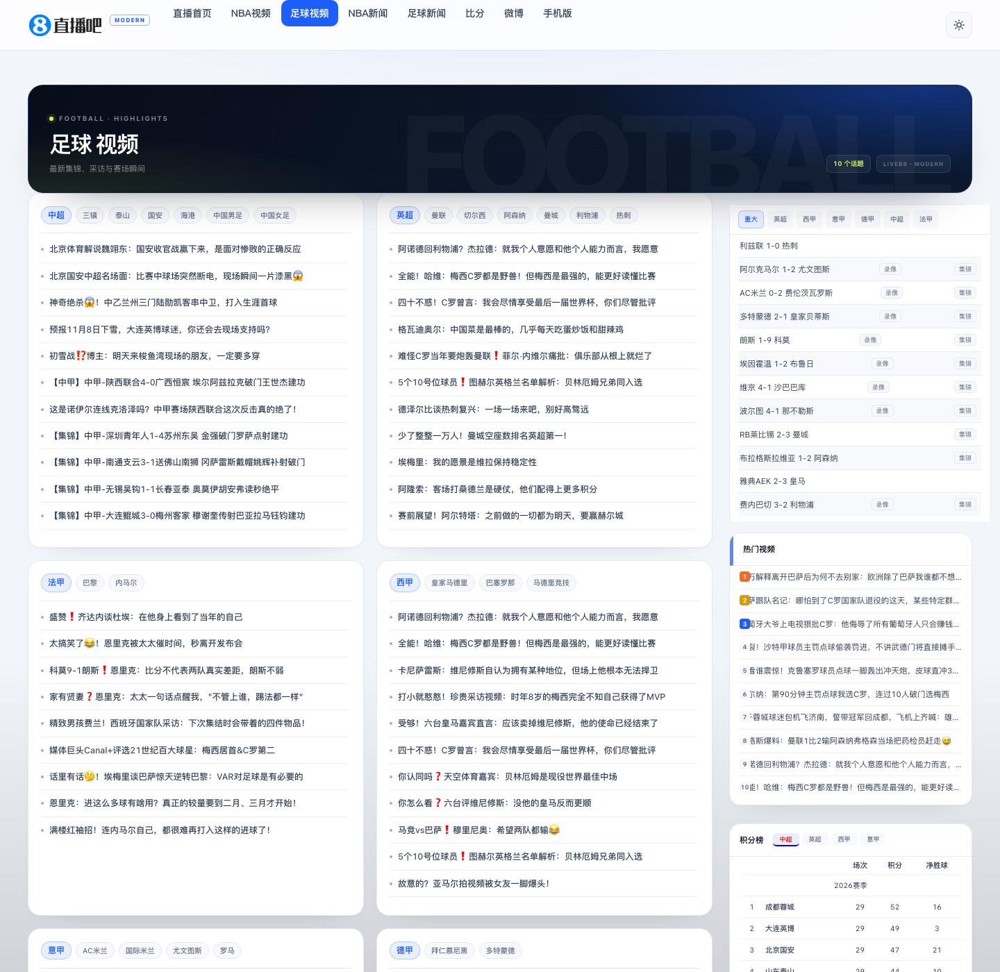
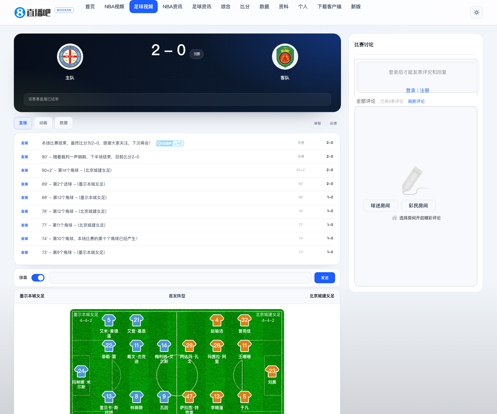
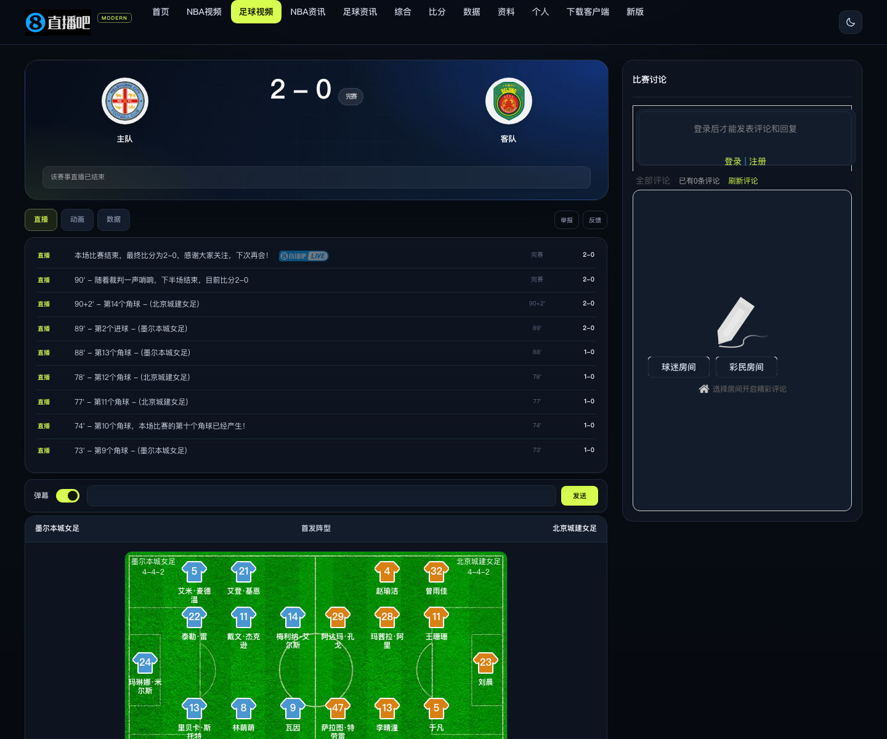
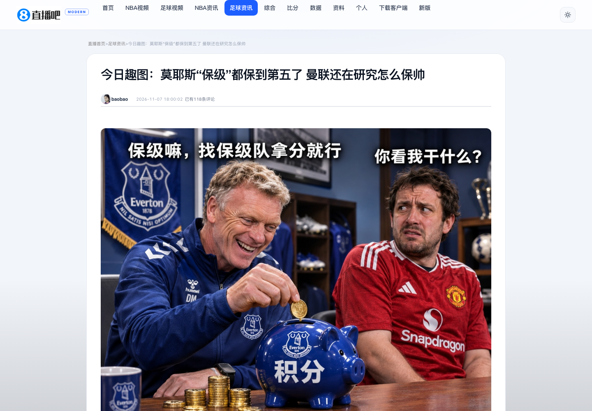

<div align="center">
  
  <h1>直播吧 Modern</h1>
  <p><strong>为 <a href="https://zhibo8.com/">直播吧</a> 桌面端重新设计的现代主题 Chrome 扩展</strong></p>
  <p>更清晰的层级、更舒服的留白，以及一套真正好用的深色模式。</p>

  <p>
    <a href="https://github.com/niexia/zhibo8-modern/releases"></a>
    <a href="LICENSE"></a>
    
    
  </p>

  <a href="docs/screenshots/comparison.png">
    
  </a>
</div>

> [!NOTE]
> 这是一个非官方的开源主题项目，与直播吧没有隶属关系。扩展只改变页面的视觉层，不修改、不代理、也不抓取网站内容。页面内容与图片仍来自直播吧及其 CDN。

## 覆盖范围

| 页面 | 支持 |
| --- | :---: |
| 首页 | ✅ |
| NBA 视频 / 足球视频频道 | ✅ |
| NBA 资讯 / 足球资讯频道 | ✅ |
| 电竞资讯 / 电竞视频频道 | ✅ |
| 综合资讯 / 综合视频频道 | ✅ |
| 完赛赛程归档 | ✅ |
| 足球 / 篮球 / 其他项目直播详情 | ✅ |
| 资讯文章 / 视频详情 | ✅ |
| 比分、数据、资料、个人中心、下载、反馈、微博 | — 外部站点 |
| 滚动资讯、录像列表、旧版页面 | — 站点旧模板 |

比分、数据、资料、个人中心、下载、反馈和微博属于独立域名或外部服务；滚动资讯、录像列表和“旧版”页面使用站点遗留模板，本版本保持原样。站内所有主要频道和直播详情页都已接入统一的导航、主题、排版与响应式布局。

## 特性

- **现代内容网格**：更宽的版心、更明确的标题层级、更舒展的卡片与列表。
- **明暗主题**：跟随系统 / 浅色 / 深色三种模式；点击导航栏右上角按钮即可快速切换。
- **今日比赛速览**：从页面现有赛程中读取对阵，生成可横向浏览的 Match Center，并可跳回完整赛程（仅首页）。
- **频道与详情页统一设计**：NBA、足球、电竞、综合频道，以及足球 / 篮球 / 其他项目直播页都有同一套导航、卡片、比分与表格语言。
- **内容详情阅读模式**：资讯文章和视频详情页使用独立的阅读版心、标题层级与评论区域。
- **重新设计的信息模块**：足球 / 篮球视频、资讯、完赛比分、电竞资讯、球队榜与球员榜都使用统一的视觉语言。
- **仍然是你熟悉的直播吧**：链接、筛选、比分标签页、赛程交互全部保留，扩展不改写站点数据。
- **响应式布局**：针对 1440、1280、1024、768px 视口做了分级适配，频道、比分表和直播页在窄屏下自动重排。
- **滚动时保持上下文**：顶部导航与赛程筛选栏保持吸顶，筛选浮层会跟随筛选栏。
- **随手开关**：在扩展弹窗里关闭主题，页面立即恢复原样，无需刷新。
- **零追踪**：不引入分析、广告或遥测；扩展本身不发起任何外部网络请求。

## 截图

### 浅色主题

<a href="docs/screenshots/after-light.png">
  
</a>

### 深色主题

<a href="docs/screenshots/after-dark.png">
  
</a>

### 频道页

<a href="docs/screenshots/channel-light.png">
  
</a>

### 直播详情页

<a href="docs/screenshots/live-light.png">
  
</a>

<p align="center">
  <a href="docs/screenshots/live-dark.png"></a>
  &nbsp;&nbsp;
  <a href="docs/screenshots/detail-light.png"></a>
</p>

<p align="center">
  <a href="docs/screenshots/popup-light.png"></a>
  &nbsp;&nbsp;
  <a href="docs/screenshots/popup-dark.png"></a>
</p>

## 安装

### 从源码安装（推荐用于当前版本）

1. 下载本仓库（`Code` → `Download ZIP`），或执行：
   ```bash
   git clone https://github.com/niexia/zhibo8-modern.git
   ```
2. 打开 Chrome，在地址栏输入 `chrome://extensions/`。
3. 打开右上角的 **开发者模式 / Developer mode**。
4. 点击 **加载已解压的扩展程序 / Load unpacked**，选择 `zhibo8-modern` 文件夹（包含 `manifest.json` 的那一层）。
5. 打开或刷新 [zhibo8.com](https://zhibo8.com/)；站内频道、赛程与详情页会自动套用主题。

支持 Chrome 111 及以上版本，以及其他基于 Chromium 111+ 的桌面浏览器。外部域名与旧版模板不在覆盖范围内。

### 已打包的 ZIP

如果 Releases 中提供了 ZIP，请先解压，再按上面的“加载已解压的扩展程序”安装。Chrome 不允许直接安装未上架的 `.crx` 文件。

## 使用

- **导航栏右上角的图标**：在浅色和深色之间快速切换；当前选择会同步到浏览器账户。
- **扩展弹窗**：
  - 开关整套现代化主题。
  - 选择 **跟随系统 / 浅色 / 深色**。
  - 显示或隐藏首页顶部的比赛速览。
- 首页顶部速览只读取页面上已经渲染的赛程；使用网站自带的“重要 / 足球 / 篮球”等筛选时，速览会自动更新。
- 频道页与直播页共用同一套主题选择；顶部的频道页签会根据当前页面自动高亮。

## 设计说明

这不是简单地换一套颜色：

- 版心从固定 1200px 改为最大 1360px，并在宽屏上使用 1fr + 380px 的主次栏结构。
- 卡片统一为 20px 圆角、1px 描边和更轻的阴影；用分类色区分足球、篮球、电竞与榜单。
- 资讯列表加入编号与节奏，视频缩略图改为更易扫读的 3 列网格。
- 赛程从“文字墙”变成时间胶囊 + 赛事信息 + 操作标签的结构；筛选栏在滚动时保持可用。
- Match Center 使用站内数据生成对阵卡片，不新增任何接口请求。
- 深色主题使用近黑蓝底与荧光黄绿点缀；浅色主题用钴蓝和高留白保持轻快。
- 频道页使用深色频道 Hero + 内容卡片网格；直播页把比分板、事件流、阵容和统计表统一为可读的卡片结构。
- 图文 / 视频详情页采用窄版阅读布局，正文限制在舒适的阅读宽度内。

所有样式都包在 `html.zb8-on` 作用域下，注入的 UI 带 `zb8-` 前缀，尽量降低对原站脚本的影响。

## 工作原理

```
manifest.json      Chrome Extension Manifest V3
content.js         主题状态、顶部速览、导航快捷开关
theme.css          全部视觉覆盖（作用域：html.zb8-on）
popup.html/css/js  设置面板
icons/             扩展图标
```

- `content.js` 在 `document_start` 运行，先识别页面类型（首页 / 频道 / 直播 / 详情 / 赛程），再给 `<html>` 加上 `zb8-on`。
- 只有首页会注入 Matchday 速览；频道页、赛程页会注入频道 Hero；详情页保留原有标题作为主标题。
- CSS 文件由浏览器预先加载，但所有规则都依赖 `zb8-on`，关闭扩展时立即失效。
- 比赛速览通过 `textContent` 与 DOM API 构建，不把站点 HTML 直接插入新节点。
- 主题和开关保存在 `chrome.storage.sync`，并在页面与弹窗之间实时同步。
- 关闭主题会移除所有注入节点和 class，恢复原站布局。

## 权限与隐私

扩展只申请 `storage` 权限；内容脚本只在 `https://zhibo8.com/*`、`https://www.zhibo8.com/*` 与 `https://news.zhibo8.com/*` 运行。没有 `tabs`、历史记录、Cookie 或网络请求权限。

完整的隐私说明见 [PRIVACY.md](PRIVACY.md)。

## 本地开发

本项目没有构建步骤，也不需要 `npm install`：

```bash
git clone https://github.com/niexia/zhibo8-modern.git
cd zhibo8-modern
```

然后按“从源码安装”的步骤加载目录。修改代码后，在 `chrome://extensions/` 点击扩展卡片上的刷新按钮，再刷新直播吧页面即可。

常用检查：

```bash
node --check content.js
node --check popup.js
python3 -m json.tool manifest.json > /dev/null
```

生成可分发 ZIP（需要 `node`、`python3`、`zip`）：

```bash
./scripts/package.sh
# dist/zhibo8-modern-v1.1.0.zip
```

发布前建议手动检查：

- 1440px、1280px、1024px、768px 下无横向滚动。
- 浅色 / 深色 / 跟随系统三种模式下文字对比度正常。
- 关闭扩展后原站背景、赛程、导航恢复。
- 首页赛程的“全部 / 重要 / 完成 / 足球 / 篮球”等筛选仍可用。
- 点击视频、资讯、比分条目会打开原来的链接。
- 频道页、直播页和详情页的浅色 / 深色 / 窄屏布局正常。

## 已知限制

- 比分、数据、资料、个人中心、下载、反馈、微博是外部站点或服务；滚动资讯、录像列表和旧版页面使用独立旧模板，本期未覆盖。
- 网站由服务端渲染 + jQuery / Avalon 动态填充，部分榜单、直播事件和未来赛程需要滚动或等待接口返回后才会加载。
- 如果直播吧调整 DOM 结构或 class 名，主题可能需要相应更新；欢迎提交 issue 或 PR。
- 主题不会阻止网站自身的广告或统计行为——它只改变样式，不修改站点脚本。

## 贡献

欢迎提交 issue 与 pull request。请尽量：

1. 保持对原站功能的兼容；
2. 不引入追踪、远程脚本或额外权限；
3. 在浅色与深色下分别截屏或说明测试结果；
4. 一次 PR 聚焦一个改动。

## Changelog

版本变更见 [CHANGELOG.md](CHANGELOG.md)。

## License

[MIT](LICENSE) © 2026 Zhibo8 Modern contributors

直播吧名称、Logo 与页面内容的相关权利归其权利人所有。本项目不包含网站源码或图片资源，仅通过公开页面进行样式增强。若权利人认为本项目不妥，请通过 issue 联系，我们会及时处理。
