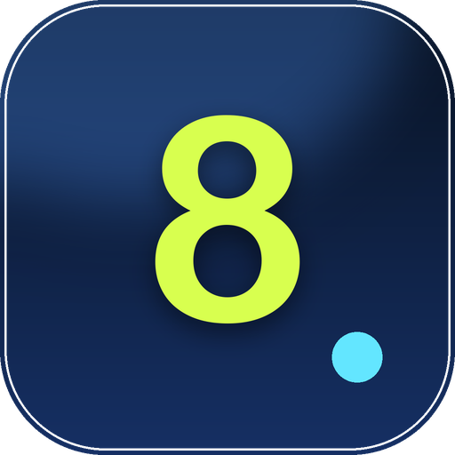
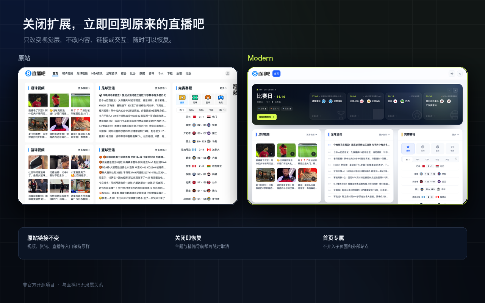
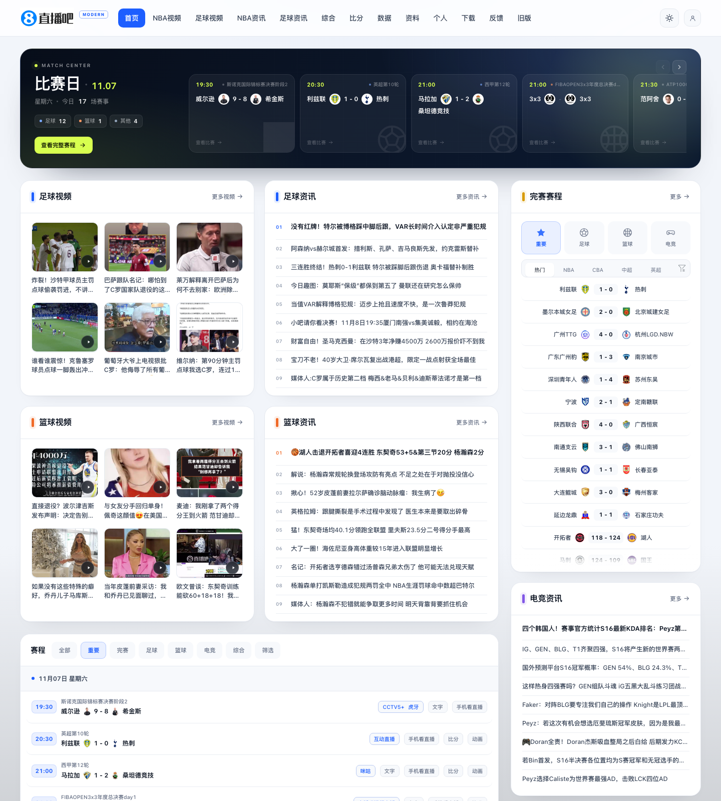
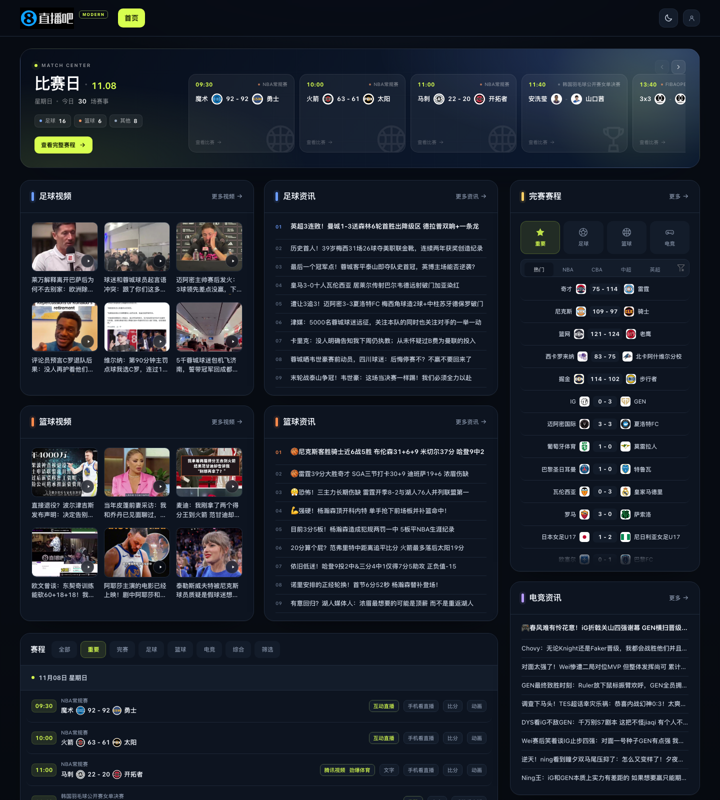
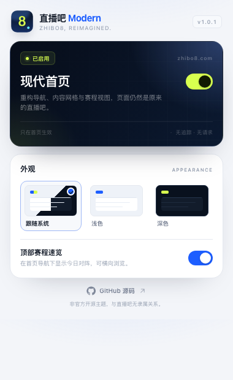
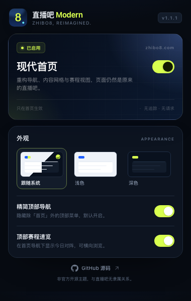

<div align="center">
  
  <h1>直播吧 Modern</h1>
  <p><strong>为 <a href="https://zhibo8.com/">zhibo8.com</a> 首页重新设计的现代主题 Chrome 扩展</strong></p>
  <p>更清晰的层级、更舒服的留白，以及一套真正好用的深色模式。</p>

  <p>
    <a href="https://github.com/niexia/zhibo8-modern/releases"></a>
    <a href="LICENSE"></a>
    
    
  </p>

  <a href="docs/screenshots/comparison.png">
    
  </a>
</div>

> [!NOTE]
> 这是一个非官方的开源主题项目，与直播吧没有隶属关系。扩展只改变页面的视觉层，不修改、不代理、也不抓取网站内容。页面内容与图片仍来自直播吧及其 CDN。

## 特性

- **只改首页**：只对直播吧首页套用现代主题；首页里的视频、资讯、直播、比分等链接进入的原站子页面完全不改动。
- **现代内容网格**：更宽的版心、更明确的标题层级、更舒展的卡片与列表。
- **精简顶部导航（默认开启）**：隐藏除「首页」外的全部顶部菜单入口；可在扩展弹窗中一键恢复完整导航。
- **明暗主题**：跟随系统 / 浅色 / 深色三种模式；点击导航栏右上角按钮即可快速切换。
- **今日比赛速览**：从页面现有赛程中读取对阵，生成可横向浏览的 Match Center，并可跳回完整赛程。
- **重新设计的信息模块**：足球 / 篮球视频、资讯、完赛比分、电竞资讯、球队榜与球员榜都使用统一的视觉语言。
- **仍然是你熟悉的直播吧**：链接、筛选、比分标签页、赛程交互全部保留，扩展不改写站点数据。
- **响应式布局**：针对 1440、1280、1024、768px 视口做了分级适配，窄屏下自动转为单列。
- **滚动时保持上下文**：顶部导航与赛程筛选栏保持吸顶，筛选浮层会跟随筛选栏。
- **随手开关**：在扩展弹窗里关闭主题或精简导航，页面立即恢复原样，无需刷新。
- **零追踪**：不引入分析、广告或遥测；扩展本身不发起任何外部网络请求。

## 截图

### 浅色主题

<a href="docs/screenshots/after-light.png">
  
</a>

### 深色主题

<a href="docs/screenshots/after-dark.png">
  
</a>

### 扩展弹窗

<p align="center">
  <a href="docs/screenshots/popup-light.png"></a>
  &nbsp;&nbsp;
  <a href="docs/screenshots/popup-dark.png"></a>
</p>

## Chrome Web Store

商店上架资料已经整理在 [store/README.md](store/README.md)，包括：

- [商品页文案](store/listing-zh-CN.md)
- [完整描述纯文本](store/description.txt)
- [隐私问卷答案](store/privacy-practices.md)
- [审核测试说明](store/test-instructions.txt)
- [5 张商店截图、图标与宣传图](store/assets/)

当前状态：上架资料已准备完成，等待提交审核。审核通过后会在这里补充 Chrome Web Store 安装链接。

## 安装

### 从源码安装（推荐用于当前版本）

1. 下载本仓库（`Code` → `Download ZIP`），或执行：
   ```bash
   git clone https://github.com/niexia/zhibo8-modern.git
   ```
2. 打开 Chrome，在地址栏输入 `chrome://extensions/`。
3. 打开右上角的 **开发者模式 / Developer mode**。
4. 点击 **加载已解压的扩展程序 / Load unpacked**，选择 `zhibo8-modern` 文件夹（包含 `manifest.json` 的那一层）。
5. 打开或刷新 [zhibo8.com](https://zhibo8.com/)，即可看到新首页。

支持 Chrome 111 及以上版本，以及其他基于 Chromium 111+ 的桌面浏览器。**主题只在首页生效**；`/nba/`、`/zuqiu/`、资讯、直播和比分等子页面保持直播吧原样，首页链接会正常打开它们。

### 已打包的 ZIP

如果 Releases 中提供了 ZIP，请先解压，再按上面的“加载已解压的扩展程序”安装。Chrome 不允许直接安装未上架的 `.crx` 文件。

## 使用

- **导航栏右上角的图标**：在浅色和深色之间快速切换；当前选择会同步到浏览器账户。
- **扩展弹窗**：
  - 开关整套现代化主题。
  - 选择 **跟随系统 / 浅色 / 深色**。
  - 显示或隐藏首页顶部的比赛速览。
  - 开关 **精简顶部导航**（默认开启）：选择关闭后，所有顶部菜单会恢复显示。
- 顶部速览只读取页面上已经渲染的赛程；使用网站自带的“重要 / 足球 / 篮球”等筛选时，速览会自动更新。
- 首页链接的行为保持原样，点击视频、资讯、直播或比分入口会进入直播吧自己的目标页面，扩展不会给这些页面注入任何样式。

## 设计说明

这不是简单地换一套颜色：

- 版心从固定 1200px 改为最大 1360px，并在宽屏上使用 1fr + 380px 的主次栏结构。
- 卡片统一为 20px 圆角、1px 描边和更轻的阴影；用分类色区分足球、篮球、电竞与榜单。
- 资讯列表加入编号与节奏，视频缩略图改为更易扫读的 3 列网格。
- 赛程从“文字墙”变成时间胶囊 + 赛事信息 + 操作标签的结构；筛选栏在滚动时保持可用。
- Match Center 使用站内数据生成对阵卡片，不新增任何接口请求。
- 深色主题使用近黑蓝底与荧光黄绿点缀；浅色主题用钴蓝和高留白保持轻快。

所有样式都包在 `html.zb8-on` 作用域下，注入的 UI 带 `zb8-` 前缀，尽量降低对原站脚本的影响。

## 工作原理

```
manifest.json      Chrome Extension Manifest V3
content.js         主题状态、顶部速览、导航快捷开关
theme.css          全部视觉覆盖（作用域：html.zb8-on）
popup.html/css/js  设置面板
icons/             扩展图标
```

- `content.js` 在 `document_start` 运行，只处理首页路径；在读取设置后给 `<html>` 加上 `zb8-on`。
- CSS 文件由浏览器预先加载，但所有规则都依赖 `zb8-on`，关闭扩展时立即失效。
- 比赛速览通过 `textContent` 与 DOM API 构建，不把站点 HTML 直接插入新节点。
- 主题和开关保存在 `chrome.storage.sync`，并在页面与弹窗之间实时同步。
- 关闭主题会移除所有注入节点和 class，恢复原站布局。

## 权限与隐私

扩展只申请 `storage` 权限；内容脚本只在 `https://zhibo8.com/*` 与 `https://www.zhibo8.com/*` 运行。没有 `tabs`、历史记录、Cookie 或网络请求权限。

完整的隐私说明见 [PRIVACY.md](PRIVACY.md)。

## 本地开发

本项目没有构建步骤，也不需要 `npm install`：

```bash
git clone https://github.com/niexia/zhibo8-modern.git
cd zhibo8-modern
```

然后按“从源码安装”的步骤加载目录。修改代码后，在 `chrome://extensions/` 点击扩展卡片上的刷新按钮，再刷新直播吧页面即可。

常用检查：

```bash
node --check content.js
node --check popup.js
python3 -m json.tool manifest.json > /dev/null
```

生成可分发 ZIP（需要 `node`、`python3`、`zip`）：

```bash
./scripts/package.sh
# dist/zhibo8-modern-v1.1.1.zip
```

发布前建议手动检查：

- 1440px、1280px、1024px、768px 下无横向滚动。
- 浅色 / 深色 / 跟随系统三种模式下文字对比度正常。
- 关闭扩展后原站背景、赛程、导航恢复。
- 精简导航默认只显示「首页」，关闭开关后全部菜单恢复。
- 首页中的各类链接都能正常打开原站子页面。
- 首页赛程的“全部 / 重要 / 完成 / 足球 / 篮球”等筛选仍可用。
- 点击视频、资讯、比分条目会打开原来的链接。

## 已知限制

- 只支持首页是有意为之：直播吧的频道、新闻子域、直播详情、旧版页面各有独立模板，本扩展不介入这些页面。
- 比分、数据、资料、个人中心等外部站点也不会被修改。
- 网站由服务端渲染 + jQuery 动态填充，部分榜单与未来赛程需要滚动到可视区域后才会加载。
- 如果直播吧调整 DOM 结构或 class 名，主题可能需要相应更新；欢迎提交 issue 或 PR。
- 主题不会阻止网站自身的广告或统计行为——它只改变样式，不修改站点脚本。
- 精简导航只隐藏顶部入口，不影响首页中的任何链接目标。

## 贡献

欢迎提交 issue 与 pull request。请尽量：

1. 保持对原站功能的兼容；
2. 不引入追踪、远程脚本或额外权限；
3. 在浅色与深色下分别截屏或说明测试结果；
4. 一次 PR 聚焦一个改动。

## Changelog

版本变更见 [CHANGELOG.md](CHANGELOG.md)。

## License

[MIT](LICENSE) © 2026 Zhibo8 Modern contributors

直播吧名称、Logo 与页面内容的相关权利归其权利人所有。本项目不包含网站源码或图片资源，仅通过公开页面进行样式增强。若权利人认为本项目不妥，请通过 issue 联系，我们会及时处理。
